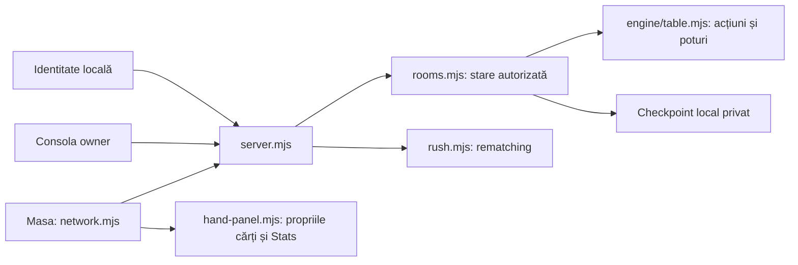

# Documentația funcțională REA / DanGG

Aceasta este versiunea publică a fișelor detaliate. Explică aspectul,controalele,condițiile,fluxurile frontend/backend,validarea,erorile și limitele cunoscute. Nu este o declarație de paritate1:1 completă. [FEATURES](../../FEATURES.md) păstrează inventarul de implementare,iar [STATUS](../../STATUS.md) rezumă starea aplicației.

## Cuprins

| Fișă | Acoperire |
|---|---|
| [Hold’em seat coordinates](cash-preview-seat.md) | Original six-seat indexing,scaled origins,marker top-left/dealer offset and heads-up priority |
| [Hold’em player plates](cash-preview-player.md) | Native64×46 background,actual balance and authenticated own styling; remaining text/parent contracts |
| [Previzualizare Hold’em:textură și buy-in](cash-preview-surface.md) | PR260:textură originală,scară/etichetă/font/culoare,reguli reale fixed/range,captură după și limite |
| [Comparație nativă la aceeași dimensiune](native-table-comparison.md) | 1200×963:capturi reale,fixture izolată,diferențe confirmate,fundal/etichetă/metadata/promoții și limite |
| [Table View:cont autentificat și așteptare](cash-table-account.md) | PR257:identitate reală,portocaliu/font nativ,Wait/Cancel/contor,confidențialitate și actualizare fără pierderea marcajelor |
| [Table View:grafica și contoare](cash-table-paint.md) | PR255:font/culori/indicator native,contoare originale97×9,măști,stări și limite |
| [Table View:ordine și deschidere](cash-table-order.md) | PR253:mese reale,priorități native,număr de jucători,săgeți,Enter/dublu clic fără debit,restart |
| [Ordinea Group și tastatura](cash-group-order.md) | PR251:reguli native,săgeți fără wrap,Enter/dublu clic cu confirmare fără debit,teste și restart |
| [Cont propriu și marcaje private Group](cash-group-paint.md) | PR249: identitate confirmată, font nativ, memo/culoare, protecție la răspunsuri întârziate și citire fără istoric |
| [Jucători Group și operator](cash-group-players.md) | PR247:locuri reale,sortare,Profile/HUD/note private,Open fără debit,plecare/restart și metadate necunoscute |
| [Grafica Group](cash-group-row.md) | PR245:cinci coloane,badge/indicator originale,șase stăriJoin,drag-away și masă închisă |
| [Group Hold’em](cash-group-aggregation.md) | PR243:agregare reală după reguli,total jucători,buy-in implicit,selecție Group/Table și limite grafice |
| [Group BuyIn/Advanced](cash-group-funding.md) | PR239:1–6mese finanțate atomic,preferințe,retry fără debit dublu,ferestre și restart |
| [Group Info](cash-group-info.md) | PR241:popup364×526,texte/fonturi/cadru native și închidere fără debit |
| [Join manual](lobby-join-confirmation.md) | Rezervare,confirmare buy-in,Escape și recuperare |
| [Smart HUD din lobby](lobby-preview-hud.md) | Observator/propriul cont,note/istoric/raportări și limite private |
| [Auto Fold](auto-fold.md) |169categorii native,editor,procent,poziții,timer,identitate,payout și restart |
| [Butoane Battle](battle-action-buttons.md) | Grafica,sliderul și stările controalelor Battle Royale |
| [Push Seat](push-seat.md) | PR213 local opt-in,selector nativ,rotație,rezervări,Ready,payout și restart;politici private neconfirmate |
| [Short Deck Sit Out](shortdeck-sitout.md) | Ante/blind pe buton,pauză/revenire,computere,scope global,payout și restart |
| [Pauză cash + Rush](global-cash-rush.md) | Scope existent,atomicitate,coadă,override,finanțare,payout și restart;limite all-games |
| [Cash Sit Out](cash-sitout-menu.md) | Pauză curentă/globală,meniul nativ,route header/grafică/stări și limite next-blind |
| [Straddle](straddle-contract.md) | Contract recuperat și reguli de server încă neverificate |
| [Bet and Muck](bet-and-muck.md) | Acțiune,cărți ascunse,condiții,eroare și ranguri |
| [Spin & Gold](spin-configuratie-nativa.md) | Configurație,roată,blinduri,asigurare și funcții încă neactivate |
| [Controale locale](registru-controale-locale.md) |149 controale HTML statice în8 pagini,limite și referințe sursă |
| [Administrare](controale-dinamice-admin.md) | Editare,duplicare,chat,backup,restaurare și confirmări |
| [Jucător](controale-dinamice-jucator.md) | Pariuri,preseturi,rezervări,hotkeys și istoric |
| [HUD,note și raportări](hud-note-raportari.md) | Statistici,eșantioane,note private,raportare și revizuire |
| [HUD nativ](hud-sesiune-all-time.md) | Sesiune/all-time,protocoale,rutare,Stats și geometrie |
| [HandRank](handrank-nativ.md) | Cărți,animații,două boarduri,sesiune persistentă,draw-uri și butoane |
| [Helmet](helmet-local.md) | Contract nativ,server,selector între ferestre,chat și grafica originală |
| [Reacții statice](reaction-motion.md) | Curbă nativă,ancore,dismissal și Add Chips concurent |
| [Bule text](chat-bubbles.md) | Grafică,Arial,ancore,scurtare,durată și Helmet |
| [Meniu emoji](emoji-menu.md) | Inventar nativ și componente încă netrasate |

## Starea curentă și proveniența

PR249 este instalat după 18 verificări pe `309e4f6c85211ef19f1d4f48d3e16f9c44a51b2e`. Contul propriu este identificat de server și afișat cu fontul Bold Italic și culoarea originale. Marcajele memo/culoare folosesc grafica nativă și o proiecție privată fără textul notei, istoric, cărți sau tokenuri. Au trecut testele de confidențialitate, restart, Group/manual Join/HUD/Auto Buy-In și șase sesiuni cu all-in-uri inegale, fold, returnări și înlocuire. Datele proprietarului au rămas identice. Metadata operatorului, personalizarea culorii implicite și paritatea fizică/timing rămân incomplete. HTML/inventarele generate sunt încă la216; fișele Markdown sunt actualizate249.

Checkpoint istoric:

PR #36–41 au integrat Helmet în cash/Rush,coordonarea între ferestre,grafica și mișcarea reacțiilor și confirmarea Add Chips după recitirea stării. PR #41 a trecut19verificări pe889147719cabea25bdb301e8c6f99638834bd0f2. Fișele de bule text și meniu emoji separă funcțiile implementate de inventarul încă incomplet.

Panoul local HandRank/HUD/Stats folosește propriile cărți cunoscute,geometrie urmărită din sursă,statistici private de sesiune și cele9 etichete de draw pe flop/turn. Sloturile native complete de animație,bitmapurile butoanelor,două boarduri în joc,TimeBankCard,sit-out și statisticile globale rămân incomplete ori neverificate. Nu echivalăm fiecare resursă identificată cu o funcție implementată.

Furnizorul REA a respins formatul SWF;analiza clientului a continuat prin FFDec pe artefactul păstrat Game/51/IronDesktop.swf. Nu pretindem execuție REA nativă reușită. Corpusul local este inventariat în raportul privat,cu hashuri și rădăcini de export distincte;nu toate rădăcinile au automat proveniență demonstrată din același SWF.14854 frame-uri grafice sunt inventariate,iar75 stări sunt explicate explicit. Frame,iconiță și funcție nu sunt sinonime.

## Frontend și backend local

[server.mjs](../../server.mjs) deservește aplicația și validează operațiile. [rooms.mjs](../../rooms.mjs) păstrează mesele,mâinile,sesiunile și limitele de acces;[rush.mjs](../../rush.mjs) gestionează pool-urile. Motorul [engine/table.mjs](../../engine/table.mjs) aplică acțiunile,iar [engine/hand.mjs](../../engine/hand.mjs) selectează combinațiile și calculează hinturile cosmetice de draw. Hinturile nu participă la distribuirea poturilor.

[network.mjs](../../network.mjs) conectează masa jucabilă la starea autorizată,[hand-panel.mjs](../../hand-panel.mjs) afișează panoul propriu,[player-note-ui.mjs](../../player-note-ui.mjs) gestionează HUD/note/istoric/raportări,iar [felt.css](../../felt.css) definește aspectul mesei. Fișele detaliază limitele fiecărei suprafețe;backendul privat al operatorului nu este recuperat și administrarea locală este independentă.

## Schema parcursului local



Schema arată componentele principale ale parcursului,nu toate endpointurile. Controalele care schimbă jocul trimit cereri validate de server;panoul HandRank citește datele proprii autorizate și calculează hinturi cosmetice. Persistența și reconectarea sunt responsabilități ale backendului local.

## Dovezi publice și private

Sursa,testele și aceste manuale sunt versionate. Capturile de cont,cheia owner,cookie-urile,PIN-urile,datele reale de joc,căile personale ale Mac-ului și dovezile brute de autentificare nu sunt publicate. Raportul HTML,catalogul vizual extins și receipturile JSON rămân locale. Numele lor din fișe sunt referințe de audit,nu linkuri către fișiere incluse aici.

Pachetul original de grafică/audio rămâne local,conform README-ului proiectului;un checkout public fără acel pachet nu demonstrează aspectul nativ. Extragerea noilor bitmapuri BestFive este pregătită,dar a fost amânată de protecția locală a discului. Fonturile,timingul fizic,redarea difuzoarelor și toate ecranele native nu sunt declarate verificate prin testele headless.

## Verificări reproductibile

```sh
node hand-draw-test.mjs
node hand-panel-test.mjs
node seat-session-test.mjs
node network-browser-test.mjs --hand-draw
node network-browser-test.mjs --history-limit --native-history-preview
node network-browser-test.mjs --bots
```

Testele browser cer Chrome și pachetul local de referință,folosesc date temporare și rulează fără activarea ferestrelor utilizatorului. Nu este necesară instalarea unor dependențe sau un build. Verificările native cu fereastră/audio sunt separate și necesită autorizarea explicită a testării în prim-plan.

- [Tournament/Spin player pause investigation](tournament-player-pause.md): native flags/global scope/return, current gaps and release acceptance; not yet implemented.

- [All-games pause candidate](all-games-pause.md): atomic mixed-format backend and HTTP; UI/release pending.

- [Sit Out callbacks and Short Deck funding](sitout-callbacks.md): fresh4009/4038protocol evidence,client4buttonBlind return threshold and still-unproven Next Blind boundary.

- [Battle final player pause](battle-final-sitout.md): phase-specific current/all-games candidate,qualified stacks,real payouts/bounties and restart; qualification pause remains separate.

- [Rabbit motion lifecycle](rabbit-motion.md): stale spread timer RED→GREEN,independent local peel evidence,early/late motion interruption and once-only cues; no inferred server sharing change.

- [Automatic Get Chips on applied cash pause](automatic-get-chips.md): native first-transition/default threshold, existing dialog, no implicit debit and no reload replay.

- [Cash lobby selected-table controls](cash-lobby-controls.md): source-backed Open/Join/Wait/Cancel and own-account queue integration.

- [Selected-table native button skins](lobby-button-skins.md): actual GlobalButton art, font initialization and pointer states.

- [Manual selected-table Join confirmation](lobby-join-confirmation.md): actual HomeMediator/ReserveSeat3104/CheckTakeSeat chain and explicit local purchase.
