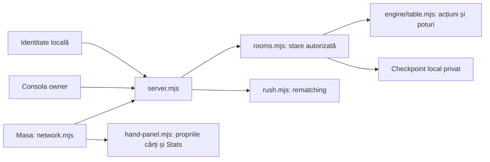

# Documentația funcțională REA / DanGG

Aceasta este versiunea publică a fișelor detaliate. Explică aspectul,controalele,condițiile,fluxurile frontend/backend,validarea,erorile și limitele cunoscute. Nu este o declarație de paritate1:1 completă. [FEATURES](../../FEATURES.md) păstrează inventarul de implementare,iar [STATUS](../../STATUS.md) rezumă starea aplicației.

## Cuprins

| Fișă | Acoperire |
|---|---|
| [Bet and Muck](bet-and-muck.md) | Acțiune,cărți ascunse,condiții,eroare și ranguri |
| [Spin & Gold](spin-configuratie-nativa.md) | Configurație,roată,blinduri,asigurare și funcții încă neactivate |
| [Controale locale](registru-controale-locale.md) |149 controale HTML statice în8 pagini,limite și referințe sursă |
| [Administrare](controale-dinamice-admin.md) | Editare,duplicare,chat,backup,restaurare și confirmări |
| [Jucător](controale-dinamice-jucator.md) | Pariuri,preseturi,rezervări,hotkeys și istoric |
| [HUD,note și raportări](hud-note-raportari.md) | Statistici,eșantioane,note private,raportare și revizuire |
| [HUD nativ](hud-sesiune-all-time.md) | Sesiune/all-time,protocoale,rutare,Stats și geometrie |
| [HandRank](handrank-nativ.md) | Cărți,animații,două boarduri,sesiune persistentă,draw-uri și butoane |
| [Helmet](helmet-local.md) | Contract nativ,server,selector între ferestre,chat și grafica originală |

## Starea curentă și proveniența

Până la PR #35,codul publicat include animațiile și descrierile complete EN ale HandRank,butoanele native,corecția WIN la dezvăluirea voluntară și recuperarea loginului local. PR #35 a fost verificat pe `07b0ee55f64296e49435e61715b517a183e59c6f` cu10verificări;rapoartele separate păstrează limitele de fidelitate. Fișa Helmet descrie acum și integrarea frontend;instalarea runtime și verificările finale sunt consemnate separat.

Panoul local HandRank/HUD/Stats folosește propriile cărți cunoscute,geometrie urmărită din sursă,statistici private de sesiune și cele9 etichete de draw pe flop/turn. Sloturile native complete de animație,bitmapurile butoanelor,două boarduri în joc,TimeBankCard,sit-out și statisticile globale rămân incomplete ori neverificate. Nu echivalăm fiecare resursă identificată cu o funcție implementată.

Furnizorul REA a respins formatul SWF;analiza clientului a continuat prin FFDec pe artefactul păstrat Game/51/IronDesktop.swf. Nu pretindem execuție REA nativă reușită. Corpusul local are469 copii/447 unități AS3 distincte în10 rădăcini de export;nu toate rădăcinile au automat proveniență demonstrată din același SWF.14854 frame-uri grafice sunt inventariate,iar75 stări sunt explicate explicit. Frame,iconiță și funcție nu sunt sinonime.

## Frontend și backend local

[server.mjs](../../server.mjs) deservește aplicația și validează operațiile. [rooms.mjs](../../rooms.mjs) păstrează mesele,mâinile,sesiunile și limitele de acces;[rush.mjs](../../rush.mjs) gestionează pool-urile. Motorul [engine/table.mjs](../../engine/table.mjs) aplică acțiunile,iar [engine/hand.mjs](../../engine/hand.mjs) selectează combinațiile și calculează hinturile cosmetice de draw. Hinturile nu participă la distribuirea poturilor.

[network.mjs](../../network.mjs) conectează masa jucabilă la starea autorizată,[hand-panel.mjs](../../hand-panel.mjs) afișează panoul propriu,[player-note-ui.mjs](../../player-note-ui.mjs) gestionează HUD/note/istoric/raportări,iar [felt.css](../../felt.css) definește aspectul mesei. Fișele detaliază limitele fiecărei suprafețe;backendul privat al operatorului nu este recuperat și administrarea locală este independentă.

## Schema parcursului local



Schema arată componentele principale ale parcursului,nu toate endpointurile. Controalele care schimbă jocul trimit cereri validate de server;panoul HandRank citește datele proprii autorizate și calculează hinturi cosmetice. Persistența și reconectarea sunt responsabilități ale backendului local.

## Dovezi publice și private

Sursa,testele și aceste manuale sunt versionate. Capturile de cont,cheia owner,cookie-urile,PIN-urile,datele reale de joc,căile personale ale Mac-ului și dovezile brute de autentificare nu sunt publicate. Raportul HTML,catalogul vizual extins și receipturile JSON rămân locale. Numele lor din fișe sunt referințe de audit,nu linkuri către fișiere incluse aici.

Pachetul original de grafică/audio rămâne local,conform README-ului proiectului;un checkout public fără acel pachet nu demonstrează aspectul nativ. Extragerea noilor bitmapuri BestFive este pregătită,dar a fost amânată de protecția locală a discului. Fonturile,timingul fizic,redarea difuzoarelor și toate ecranele native nu sunt declarate verificate prin testele headless.

## Verificări reproductibile

```sh
node hand-draw-test.mjs
node hand-panel-test.mjs
node seat-session-test.mjs
node network-browser-test.mjs --hand-draw
node network-browser-test.mjs --history-limit --native-history-preview
node network-browser-test.mjs --bots
```

Testele browser cer Chrome și pachetul local de referință,folosesc date temporare și rulează fără activarea ferestrelor utilizatorului. Nu este necesară instalarea unor dependențe sau un build. Verificările native cu fereastră/audio sunt separate și necesită autorizarea explicită a testării în prim-plan.
