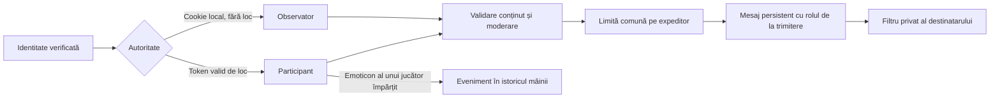

# Chatul spectatorilor — contract local și dovezi REA

## Traseul nativ recuperat

Metoda este analiză statică FFDec, fallback REA pentru SWF; nu este execuție AIR observată. TableChat.setExceptObserver modifică proprietatea ChatInfo.observerIsExcepted și MessageViewer. ChatOptionPanel emite EXCEPT_OBSERVER_CHAT cu inversul stării bifate: On înseamnă că mesajele observatorilor sunt incluse. ChatMessageViewer filtrează mesajele blocate și mesajele de observator excluse, cu excepții pentru propriul utilizator, GG moderator și Sponsored Pro. TableChatInfo pornește observerIsExcepted=false; clear() golește mesajele fără să reseteze această proprietate. Mediatorul ascunde/recuperează fereastra la închidere.

Local, toate conturile de jucător sunt obișnuite; nu sunt atribuite rolurile operatorului GG moderator/Sponsored Pro. Propriile mesaje de observator rămân vizibile când filtrul este Off. Nu acceptăm un rol privilegiat furnizat de client. Exactitatea întregului ciclu de cache al ferestrei native și rolurile privilegiate ale operatorului rămân în afara verificării realizate.

## Identitate și autorizare

Spectatorul trimite prin endpointul existent POST /api/rooms/ID/chat. Este necesar un cont local autentificat prin cookie și o masă găzduită cunoscută. Cererile fără token de loc cer Origin exact al aplicației; Origin străin, lipsa autentificării, metodele și payloadurile incorecte sunt respinse. Un cont deja așezat nu poate pretinde că este spectator: trebuie să folosească sesiunea locului său, respectând Helmet și moderarea. Un token de loc invalid nu este convertit în autoritate de spectator.

Numele și marcajul observer=true sunt stabilite de server, nu din JSON-ul clientului. Payloadul spectatorului permite exact un tip de conținut, text/reaction/emoticon, plus versiunea opțională validă. seat,name,observer,role și alte câmpuri sunt refuzate. Textul este redat literal. Spectatorii nu primesc loc, cărți private, control de joc, acces la note sau evenimente în istoricul mâinii. Un emoticon de observator apare numai în lista de chat, fără suprapunere pe un scaun.

## Persistență, limite și moderare

Se păstrează ultimele50mesaje. O identitate internă de expeditor permite limita comună de1secundă chiar la trecerea spectator→participant; acest identificator nu este trimis în răspunsul public și nu este un token de autentificare. Mesajele vechi fără identificator rămân compatibile. Rolul de la trimitere este imuabil: un mesaj postat înaintea așezării rămâne mesaj de observator.

Lista de moderare a administratorului include conturile neașezate din mesajele recente și conturile interzise. Nu reprezintă o listă de conexiuni online. seat=null identifică un cont neașezat, subject identifică exact destinatarul; un transfer de rol sau o țintă veche cere reîncărcarea listei. Interdicția este pe cont și rămâne valabilă după așezare sau reautentificare. Conturile interzise rămân gestionabile după evacuarea mesajului din fereastra de50. Auditul păstrează numele țintei confirmate, fără a confunda mai mulți observatori cu seat=null. Scrierea eșuată este anulată atomic, iar restartul păstrează mesajele, rolurile și interdicțiile.

Chatul nu debitează portofelul și nu modifică jetoanele. Versiunea publică a camerei se schimbă pentru livrarea mesajelor. Un prag intern actionVersion păstrează ultima schimbare care nu este exclusiv chat. Pariurile pot folosi o versiune anterioară numai când toate schimbările intermediare au fost mesaje de chat și nu s-a schimbat starea în timpul cererii. Versiunile viitoare, nenumerice și cele dinaintea unei mutări sunt respinse; actorul și acțiunea sunt validate normal. Celelalte operații, inclusiv finanțarea, păstrează verificările existente. Aceasta este o corecție de concurență a backendului local, nu un protocol operator recuperat.

## Interfața Observer Chat

Controlul nativ folosește iconurile table_popup0441/0442,20×20 la(14,2), eticheta Observer Chat de14px, x40,lățime180. Trackul0303/0304 este44×20 la(width−60,2); dotul0305/0306 este18×18, y3, x=width−59 Off sau width−35 On. Textul On/Off are13px și lățime20. Culorile sunt#fff/#666 pentru etichetă și#ccc/#999 pentru stare. Aceste13sprite-uri More/Helmet/Observer au6243octeți și sunt verificate RGBA față de atlasul instalat.

În More, participantul nemute are acum două rânduri funcționale, Helmet și Observer Chat, în94px. Spectatorul are doar Observer Chat în64px, fără Helmet. Helmet activ ascunde rândul observatorilor. Panoul nativ complet are și AutoTranslate:124px cu trei rânduri; traducerea încă lipsește și această diferență rămâne explicită.

Filtrul este privat destinatarului și nu schimbă camera. Ascunde numai mesajele istorice marcate observer=true ale altor conturi; mesajele proprii și cele ale participanților rămân. Preferința este păstrată în sesiunea ferestrei părinte, separată pe cont/masă, astfel încât închiderea/redeschiderea popupului nu o pierde. Nu este o preferință globală între conturi. Logoutul invalidează capacitatea de trimitere chiar dacă versiunea camerei a rămas aceeași.

## Verificări

observer-chat-test.mjs verifică identitatea, payloadurile, concurența dintre chat și pariu, respingerea acțiunilor vechi după mutări reale, moderarea/ținte vechi, persistența după50mesaje, trecerea între roluri, rollback, restart și soldul neatins. observer-chat-http-test.mjs verifică cookie/Origin/metodă/dimensiune, auditul pentru observatori diferiți, mute/unmute, logout și recuperarea datelor.

network-browser-test.mjs --helmet --observer-chat folosește doi spectatori autentificați în sesiuni separate, compozitorul real, pointer pe switchul original, excepția propriului mesaj, mesaje de participant, izolarea destinatarilor, închidere/redeschidere a popupului, moderare din consola reală, blocare la logout și o mână completă cu payout independent240jetoane. Emoticonul observatorului în timpul mâinii nu produce cărți private, overlay pe loc sau eveniment de joc. După restart, se așteaptă un document nou și formularul inițializat înainte de trimitere; același cont poate continua chatul.

Rămân: traducerea automată reală, rolurile privilegiate ale operatorului, blocarea privată între utilizatori, paritatea fizică AIR/WKWebView și toate celelalte lacune din FEATURES.md. Nu declarăm întregul chat sau întreaga aplicație1-la-1.

## Tranziția într-un popup deja deschis

Popupul verifică, între cereri, sesiunea ferestrei părinte numai dacă aceasta rămâne accesibilă, de aceeași origine și pe aceeași masă. Reutilizează tokenul emis în fluxul normal de buy-in; nu execută join/reautentificare și nu rotește tokenuri. La plecarea din loc șterge copia și starea privată înainte de revenirea la watch. Un părinte închis, străin sau trecut pe altă masă nu înlocuiește sesiunea popupului. Serverul validează în continuare cookieul și tokenul; nu există tokenuri în BroadcastChannel/localStorage. Acesta este transportul local dintre ferestre, nu un protocol recuperat al operatorului.

Testul de browser ia loc prin formularul real și confirmarea Buy-in, trimite în același popup ca participant și pleacă prin Leave table. Mesajele anterioare rămân de observator, cele noi au locul serverului; popupul revine la spectator fără reîncărcare. Părintele pe altă masă nu poate șterge copia locului curent. Testul RED a rămas blocat la Helmet ascuns după buy-in înaintea corecției.
